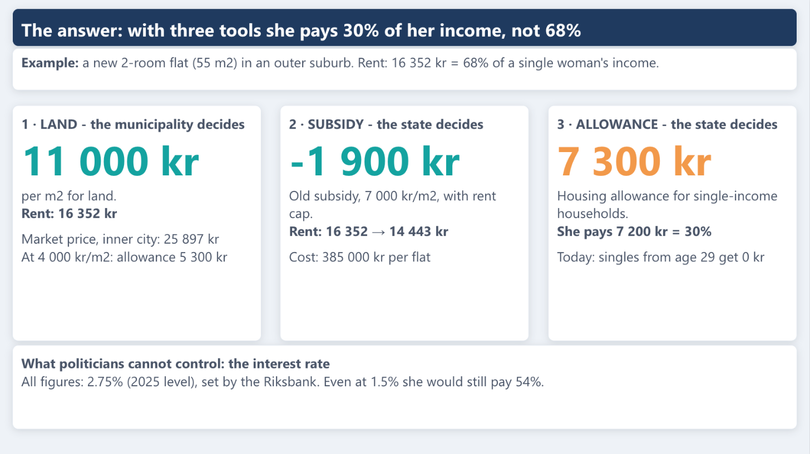
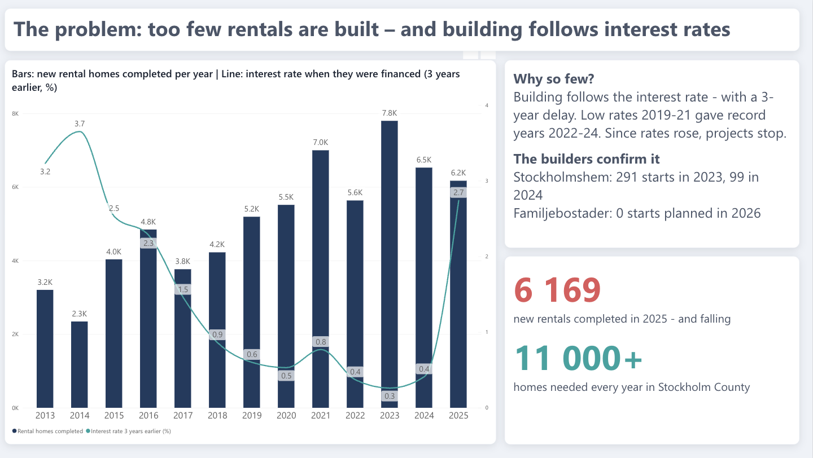
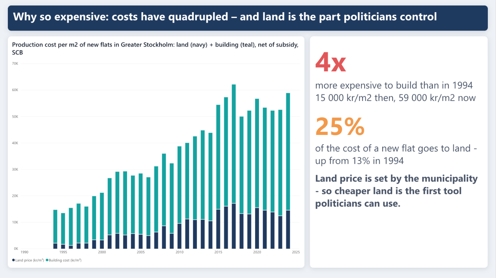
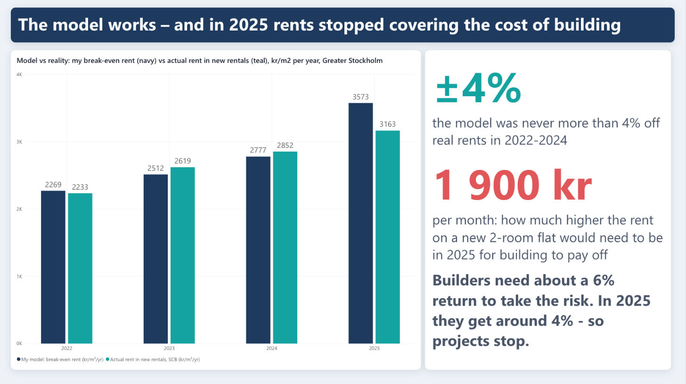
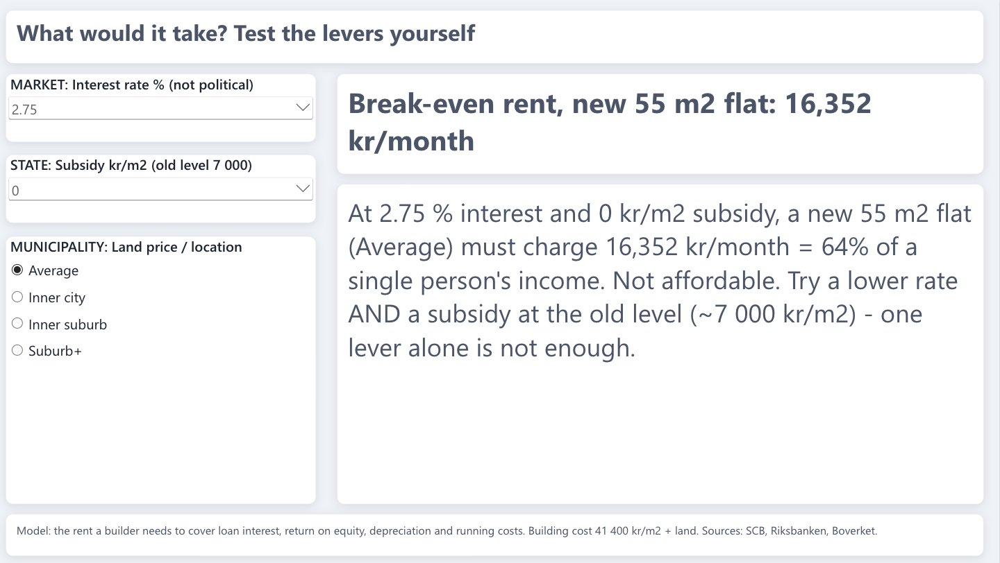
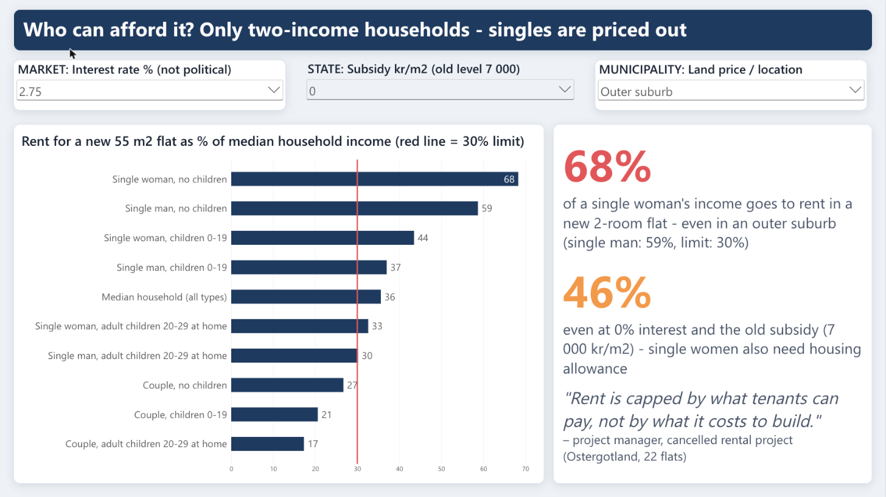

# The Cost of Building Rentals in Stockholm

**What would it take for new rental housing in Stockholm to be built at a rent ordinary households can
afford – which tools can politicians use, and how much does each one lower the rent?**

Individual project – Hyper Island, Data Analyst (DA27), autumn 2026.
Audience: politicians and decision-makers. The result is presented as an interactive Power BI report.



## Key findings

| | |
|---|---|
| **6 169** | new rental homes completed in Stockholm County in 2025 – and falling. The county needs 11 000+ new homes a year. |
| **3 years** | the lag between the interest rate and completions: low rates 2019–21 gave the record years 2022–24. |
| **4×** | production cost per m² compared with 1994. Land in the inner city costs about as much as the building itself. |
| **±4 %** | how close the break-even model came to actual rents in new rentals 2022–2024. |
| **1 900 kr/month** | the gap in 2025 between what a new 55 m² flat costs and the rent it can be let for. That gap is why projects stop. |
| **64 %** | of a single person's income would go to rent in a new 2-room flat today (limit: 30 %). Even at 0 % interest and maximum subsidy it is 42 %. |

**The tools** (55 m² flat, 2.75 % interest, today's level 16 352 kr/month):

| Tool | Who decides | Effect on rent | Cost / note |
|---|---|---|---|
| Cheaper land for rentals (inner suburb → average land price) | Municipality | **−5 200 kr/month** (inner city: −9 500) | Land allocation, discounted site leasehold |
| Investment subsidy, 7 000 kr/m² tied to a rent cap | State | **−1 900 kr/month** | ≈ 385 000 kr per flat = 385 million kr per 1 000 flats |
| Housing allowance for single-income households | State | Closes the remaining gap: **8 600 kr/month** for a single person, 4 400 for a single parent | Land and subsidy alone are not enough for one income |
| Interest rate | Riksbank / market – *not* a political tool | 1.5 % + subsidy → 12 900 kr/month: 28 % of median income, still 50 % for a single person | Policy has to work even when rates are high |

**Conclusion:** no single tool is enough. Cheaper land, a targeted subsidy and housing allowance
together can bring new rentals to a level ordinary households can afford.

## The model

Break-even rent = the rent a builder must charge per m² and year to cover all costs of a new building:

```
investment = production cost − investment subsidy
rent       = investment × LTV × (5y mortgage bond rate + bank margin)   # loan interest
           + investment × (1 − LTV) × equity return                     # return on own money
           + investment × depreciation
           + operating cost
```

| Assumption | Value | Comment |
|---|---|---|
| Loan-to-value (LTV) | 60 % | typical 50–70 % for new rental projects |
| Bank margin | +1.5 pp | on top of the 5-year mortgage bond rate |
| Required return on equity | 6 % | |
| Depreciation | 1 % per year | ~100-year building life |
| Operating cost | 450 kr/m²/year | running costs + maintenance |
| Interest rate lag | 3 years | a building is financed ~3 years before it is completed |
| Building cost | 41 400 kr/m² | SCB 2024; land price is added per location scenario |
| Land price scenarios | 11 000 / 20 000 / 30 000 / 46 000 kr/m² | Average / Suburb+ / Inner suburb / Inner city |
| Flat size | 55 m² (2 rooms) | monthly rent = rent per m² × 55 / 12 |
| Affordability limit | 30 % of disposable income | SCB median income per household type, Stockholms län |

**Validation:** with SCB production costs and the bond rate 3 years earlier, the model lands within
about 4 % of actual rents in unsubsidised new rentals (*presumtionshyra*) in Stor-Stockholm 2022–2024
(mean absolute error 73 kr/m²/year). In 2025 the model rent is 410 kr/m²/year above the actual rent –
the 1 900 kr/month gap. See `notebooks/02_model.ipynb`.

## The Power BI report

Six pages that tell the story, built to be presented full screen. Pages 4 and 5 have live sliders where
the audience can test the tools themselves.

| Page | Content |
|---|---|
| 1. The problem | Completions vs the interest rate 3 years earlier |
| 2. Why so expensive? | Production cost per m², land + building, 1994–2024 |
| 3. Can we trust the model? | Model vs actual rent 2022–2025 |
| 4. What would it take? | Sliders: interest rate (market), subsidy (state), land price (municipality) |
| 5. Who can afford it? | Rent as % of income per household type |
| 6. The answer | The three tools, their effect and cost |

Screenshots of every page and the custom theme are in [`powerbi/`](powerbi/). The data source of the
report is `data/processed/rental_model_powerbi.xlsx` (Import mode).

| | |
|---|---|
|  |  |
|  |  |
|  |  |

## Project structure

```
rental-housing-stockholm/
├── data/
│   ├── raw/                  # data exactly as downloaded from the APIs (created by fetch_data.py)
│   └── processed/            # model output used by Power BI (created by 02_model.ipynb)
├── notebooks/
│   ├── 01_explore.ipynb      # first look at the data: completions, rates, costs, rents
│   └── 02_model.ipynb        # break-even model, validation, scenarios, affordability, export
├── powerbi/
│   ├── screenshots/          # one image per report page
│   └── theme_rental_premium.json
├── src/
│   └── fetch_data.py         # downloads all raw data from SCB and Riksbanken
├── requirements.txt
└── README.md
```

## Getting started

```bash
# 1. Create and activate a virtual environment (once)
python3 -m venv .venv
source .venv/bin/activate          # Windows: .venv\Scripts\activate

# 2. Install packages
pip install -r requirements.txt

# 3. Download the raw data (takes about a minute)
python src/fetch_data.py

# 4. Run the notebooks in order: 01_explore → 02_model
jupyter notebook notebooks/
```

`fetch_data.py` saves one CSV per dataset in `data/raw/`, a log of what was fetched (`_fetch_log.csv`)
and prints a sanity check comparing a few values with known figures. `02_model.ipynb` writes all
tables in `data/processed/`, including the Excel file used by Power BI.

## Data sources

| File in `data/raw/` | Source | Content |
|---|---|---|
| `scb_completed_dwellings_by_tenure.csv` | SCB TAB4193 | Completed dwellings by tenure (rental/co-op), Stockholms län + municipalities, 1991– |
| `scb_started_completed_quarterly.csv` | SCB TAB4572 | Started and completed dwellings per quarter, 1975– |
| `scb_production_price_by_region.csv` | SCB TAB1626 | Production price per m² (land, building, total), gross/net, Stor-Stockholm, 1994– |
| `scb_production_price_by_tenure.csv` | SCB TAB1634 | Production price per m² by tenure, metropolitan areas, 1994– |
| `scb_rents_new_2022_onwards.csv` | SCB TAB6417 | Rents in new rentals by rent-setting model (incl. with investment subsidy), 2022– |
| `scb_rents_new_2014_2022.csv` | SCB TAB4277 | Rents in new rentals, 2014–2022 (discontinued series) |
| `scb_construction_cost_index.csv` | SCB TAB6328 | Construction cost index for housing, 2021=100, quarterly |
| `scb_disposable_income.csv` | SCB TAB1492 | Disposable household income by household type, mean/median |
| `scb_lending_rates_companies.csv` | SCB TAB5780 | Lending rates to non-financial companies, monthly |
| `riksbank_interest_rates_daily.csv` | Riksbanken SWEA | Policy rate, mortgage bonds (2y, 5y), government bonds (5y, 10y), daily |

APIs: [SCB Statistikdatabasen API v2](https://statistikdatabasen.scb.se/api/v2) ·
[Riksbanken SWEA API](https://api.riksbank.se/swea/v1)

Context figures on page 1 (housing need, Stockholmshem and Familjebostäder start plans) come from public
reports by Region Stockholm and the municipal housing companies. Qualitative input comes from an
interview with the project manager of a cancelled rental project (Östergötland, 22 flats), anonymised.

## Limitations

- **Simplified financing.** One loan-to-value, margin and equity return for all projects; real
  projects differ, and builders also price in risk and the expected future value of the building.
- **Average costs.** SCB production prices are regional averages for projects completed each year, so
  they depend on where building happened that year. Location is therefore modelled as land-price
  scenarios rather than real sites.
- **Few validation years.** Rents in new rentals by rent-setting model are only published from 2022,
  so the model is validated on four years.
- **2025 cost is estimated** by inflating the 2024 production price with the construction cost index.
- **Subsidy level.** SCB's gross − net price is averaged over *all* rentals, including those without
  subsidy, so it understates the subsidy per supported project. The scenarios use up to 8 000 kr/m²
  and ~7 000 kr/m² as the old level.
- **Affordability** uses median disposable income per household type and a 30 % rule of thumb; it
  does not include existing housing allowance or savings.
- **Static model.** It shows the rent needed today, not how builders, land prices or demand would
  react to a policy change.

## Notes on the data

- "Netto" production price is after deduction of the state investment subsidy; "brutto" before.
- "Stor-Stockholm" in SCB = the 26 municipalities of Stockholms län.
- Missing values in SCB tables (`..`) are stored as empty cells.
